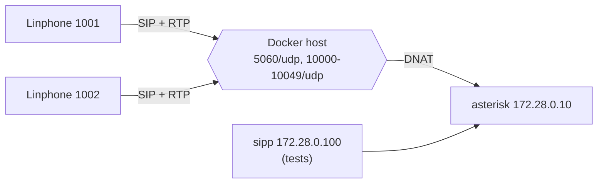

# voip-lab

Reproducible VoIP lab with Asterisk, Kamailio and RTPengine in Docker, built
from scratch as a learning project.

[](https://github.com/marcobravomendoza/voip-lab/actions/workflows/ci.yml)
[](LICENSE)

## Architecture

Phase 1: softphones on the LAN register directly on Asterisk, which runs in
a container behind Docker NAT and advertises the host LAN IP.



Target (week 4+): Kamailio as the SIP entry point and RTPengine for media in
front of Asterisk. Details, IP plan and ports: [docs/architecture.md](docs/architecture.md).

## Roadmap

| Tag  | Week | Content | Status |
|------|------|---------|--------|
| v0.1 | 1 | Asterisk built from source in Docker, 2 softphones, SIPp smoke tests | ✅ done |
| v0.2 | 2-3 | PJSIP in depth, NAT, codecs, debugging provoked failures | ⏳ planned |
| v0.3 | 4-5 | Dialplan, voicemail, music on hold, IVR | ⏳ planned |
| v0.4 | 6-7 | Kamailio + RTPengine in front of Asterisk, SIP trunk, basic security | ⏳ planned |
| v0.5 | 8-9 | Call queues (app_queue) | ⏳ planned |
| v0.6 | 10 | Recording, queue_log and CDR in a database, Grafana | ⏳ planned |
| v0.7 | 11-12 | AMI, ARI and FastAGI with Python | ⏳ planned |
| v0.8 | 13-14 | FreePBX | ⏳ planned |
| v1.0 | 15 | TLS/SRTP, Asterisk upgrade, final release | ⏳ planned |

## Quick start

Requirements: Linux host with Docker Engine and Docker Compose v2, `make`.
Recommended: `"userland-proxy": false` in `/etc/docker/daemon.json` (keeps the
real source IP of SIP/RTP packets on published ports).

```bash
git clone <repo-url> voip-lab && cd voip-lab
cp .env.example .env      # set LAB_HOST_IP and the passwords
make build                # first build compiles Asterisk (~5 min)
make up                   # waits until Asterisk is healthy
make test-phase1          # 8 checks with SIPp
```

## What to dial from a softphone

Register a softphone (UDP, no ICE/STUN) with user `1001` or `1002`, the
password from `.env` and domain `LAB_HOST_IP`.

| Number | What happens |
|--------|--------------|
| 1001-1003 | Calls that extension (20 s); `##` blind transfer, `*2` attended |
| 600 | Echo test |
| 601 | "Hello world" |
| anything else | Rejected with `404 Not Found` |

## Repository layout

```
asterisk/          Asterisk Dockerfile, entrypoint and configuration
  config/          one file per module; *.tmpl rendered from .env
tests/sipp/        SIPp image and reusable scenarios
tests/phase1/      smoke tests for phase 1
docs/              architecture, testing matrix, troubleshooting, ADRs,
                   one page per phase
.github/workflows/ CI: lint, build, start the lab, smoke tests
```

## Sample test output

```
$ make test-phase1
Phase 1 smoke tests
-------------------
  PASS  asterisk container is healthy
  PASS  3 PJSIP endpoints loaded
  PASS  UDP transport listening on 5060
  PASS  dialplan loaded (1001, 600, 601 in from-internal)
  PASS  REGISTER 1003 with valid credentials -> 200 OK
  PASS  REGISTER 1003 with wrong password is rejected (security.log)
  PASS  authenticated call 1003 -> 600 for 3 s
  PASS  CDR written for the call (ANSWERED, billsec >= 2)
-------------------
Result: all checks passed
```

Test matrix and design notes: [docs/testing.md](docs/testing.md).

## Architecture Decision Records

- [ADR 0001: Build Asterisk from source in a multi-stage Dockerfile](docs/adr/0001-build-asterisk-from-source.md)
- [ADR 0002: User-defined bridge network with fixed IPs](docs/adr/0002-bridge-network-fixed-ips.md)

## What I learned

Highlights per phase; details in each phase page.

**Week 1** ([docs/phase-1-asterisk.md](docs/phase-1-asterisk.md))
- Asterisk is a B2BUA: one call = two channels and two SIP dialogs, joined
  by a bridge; the bridge technology changed to `simple_bridge` just by
  enabling transfer features.
- Behind Docker NAT, Asterisk must advertise the host IP in Contact and SDP
  only to peers outside `local_net`.
- SIP transactions affect test tools too: reusing a Call-ID and branch made
  Asterisk replay a cached `200 OK` (a false PASS, now prevented).

Troubleshooting notes: [docs/troubleshooting.md](docs/troubleshooting.md).

## License

[MIT](LICENSE)
