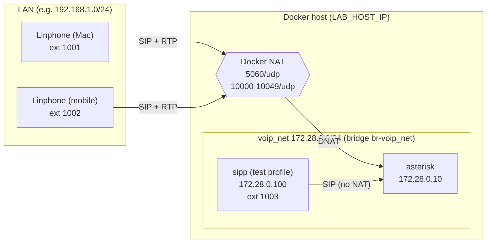
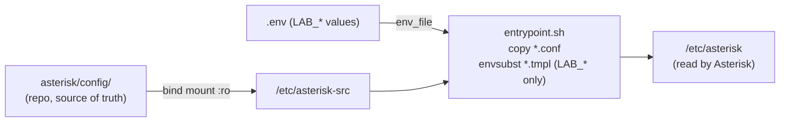
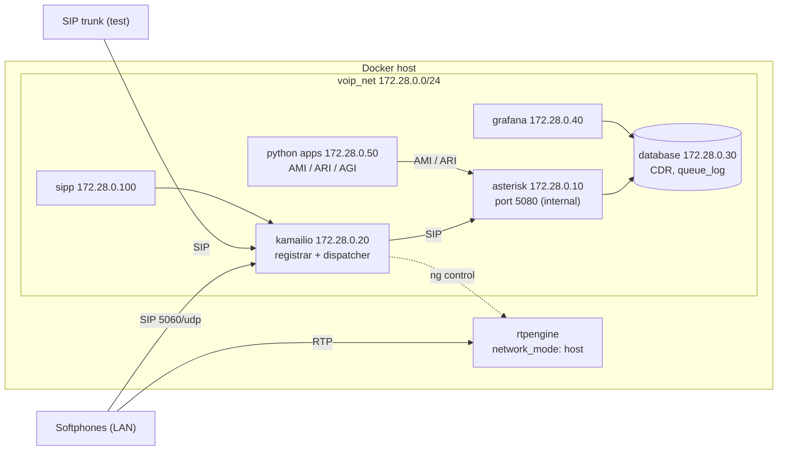

# Architecture

The lab is built in phases. This page shows the current phase (1) and the
target architecture (phase 2, week 4 onwards).

## Phase 1: Asterisk only (weeks 1-3)

Softphones on the LAN register directly on Asterisk. Asterisk runs in a
container behind Docker's NAT, so it advertises the host LAN IP to them.

How NAT is handled (`asterisk/config/pjsip.conf.tmpl`):

- `local_net = 172.28.0.0/24` (and loopback): destinations Asterisk reaches
  directly. SIPp lives here, so it sees the internal address 172.28.0.10.
- Everything else (the softphones) gets `external_signaling_address` in
  Via/Contact and `external_media_address` in the SDP `c=` line, both set to
  `LAB_HOST_IP`.
- `userland-proxy: false` in the Docker daemon keeps the real source IP of the
  phones, so `rewrite_contact`, `force_rport` and `rtp_symmetric` work.
- `direct_media = no`: media always goes through Asterisk.

### Configuration flow

`make reload` re-runs the render step and `core reload` without restarting
the container. Changes to `.env` need `docker compose up -d` (recreate).

## Target: phase 2 (week 4 onwards)

Kamailio becomes the only SIP entry point and RTPengine handles media and NAT.
Asterisk moves to an internal port and is no longer published.

## IP plan

| Service      | IP            | Phase |
|--------------|---------------|-------|
| gateway      | 172.28.0.1    | 1     |
| asterisk     | 172.28.0.10   | 1     |
| kamailio     | 172.28.0.20   | 2     |
| database     | 172.28.0.30   | 2     |
| grafana      | 172.28.0.40   | 2     |
| python apps  | 172.28.0.50   | 2     |
| sipp         | 172.28.0.100  | 1     |

## Ports

| Port / range       | Proto | Service  | Published on host | Phase | Purpose |
|--------------------|-------|----------|-------------------|-------|---------|
| 5060               | UDP   | asterisk | yes               | 1     | SIP signaling |
| 10000-10049        | UDP   | asterisk | yes               | 1     | RTP/RTCP media (same range as `rtp.conf`) |
| 5060               | UDP   | kamailio | yes               | 2     | SIP entry point (replaces Asterisk's) |
| 5080               | UDP   | asterisk | no                | 2     | SIP, internal only |
| RTPengine range    | UDP   | rtpengine| host network      | 2     | media relay (firewalld rules needed) |

Phase 1 needs no firewalld changes on the host: Docker manages published
ports through its own firewalld zone (verified on Fedora with firewalld).
